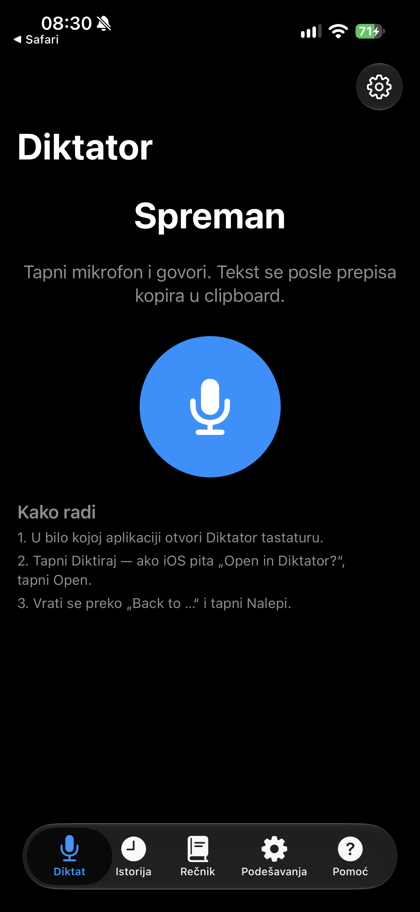

# Diktator iOS

Mobilna verzija aplikacije **Diktator** za iPhone/iPad: izdiktiraš na srpskom
ili engleskom, a tekst se lokalno prepiše i ubaci u bilo koju aplikaciju.



*Stvarni screenshot sa iPhone 15 Pro, iOS 27.0.1 (verzija 0.1.1).*

Projekat je nastao iz macOS aplikacije
[Diktator](https://github.com/cedomirovic/pitchi). Cilj je isti princip:
**snimak i tekst ostaju na uređaju**, bez slanja zvuka na server.

- GitHub: <https://github.com/cedomirovic/diktator-ios>
- Verzija: **0.1.7 (8)**
- Aplikacija: **Diktator iOS** (`com.cedomirovic.diktator.ios`)
- Tastatura: `com.cedomirovic.diktator.ios.keyboard`
- Modeli: **Large v3 Turbo q5_0** (~547 MB) za brzinu i
  **Large v3 q5_0** (~1,0 GB) za najtačniji srpski.
- Minimum iOS 17; testirano na iPhone 15 Pro (iPhone16,1), iOS 27.0.1.

## Status

Verzija **0.1.7 (8)** je potpisana i instalirana na **iPhone 15 Pro**
(iOS 27.0.1). Debug i Release build prolaze na macOS 26.7.1 i Xcode 27.1;
whisper.cpp za iOS (arm64, Metal + Accelerate) je izgrađen. Skripta pravi
nepotpisan `build/DiktatorIOS.ipa` (~1.6 MB bez modela).

Na uređaju je potvrđeno: snimanje, lokalni whisper.cpp prepis, kopiranje u
clipboard, istorija, rečnik i puna tastatura. Tastatura na iOS 26+ traži
**Allow Full Access** za čitanje clipboarda i otvaranje aplikacije dugmetom
**Diktiraj**; u gornjoj traci treba da piše **Full Access ✓**.

Nova pozadinska sesija omogućava da tastatura snima dok je otvorena bilo koja
aplikacija. Prvi `Diktiraj` otvara Diktator da uključi sesiju i odmah počinje
snimanje; posle toga tastatura ostaje u host aplikaciji i šalje `start`/`stop`.
Status i komande idu preko imenovanih pasteboard-a i Darwin notifikacija, a
gotov tekst preko clipboarda.

Na srpskom sistemu aplikacija podrazumevano bira jezik **Srpski**, a ne
automatsku detekciju. Podrazumevani način je **Brzo (Turbo)**, a u
Podešavanjima → **Brzina** možeš izabrati **Najtačnije (Large v3)** ili
**Groq (oblak)**.

## Ažuriranja

Aplikacija nije na App Store-u, pa nema sistemsku proveru ažuriranja. Zato
proverava **GitHub release** (`cedomirovic/diktator-ios`) najviše jednom u
6 sati. Kada postoji novija verzija, prikaže karticu na glavnom ekranu i
pošalje lokalno obaveštenje sa linkom na release. U Podešavanjima postoji
prekidač **Proveri nove verzije**, dugme **Proveri sada** i **Testiraj
obaveštenje** da se odmah proveri da li iOS dozvoljava notifikacije.

## Statistika

Glavni ekran ima karticu **Statistika**: današnje reči, niz dana i ušteđeno
vreme. Tap na karticu otvara detalje: ukupno reči i diktata, prosečnu brzinu
(reči/min), grafikon poslednjih 7 dana, vreme govora, najduži niz, jezike i
prosečan diktat. Statistika se računa lokalno iz broja reči i trajanja; ne
čuva tekst i može se obrisati nezavisno od istorije.

Ako Xcode ili `devicectl` prijave da uređaj nije uparen, prvo ga upari:

```bash
xcrun devicectl manage pair --device <UDID>
```

Posle toga rade i `devicectl device install app` i
`devicectl device process launch`. Telefon mora biti **otključan** da bi
`devicectl` pokrenuo aplikaciju.

## Kako radi

1. U bilo kojoj aplikaciji otvori tekstualno polje i prebaci tastaturu na
   **Diktator**.
2. Tapni **Diktiraj**. Ako sesija nije uključena, otvoriće se Diktator;
   tapni **Uključi sesiju**, pa se vrati u host aplikaciju i ponovo tapni
   **Diktiraj**. Ako iOS prikaže **„Open in Diktator?“**, tapni **Open**.
3. Govori. Tastatura prikazuje **Snimam…**.
4. Tapni **Stop** — aplikacija prepisuje lokalno. Kada piše
   **„Spremno je, nalepi.“**, tapni **Nalepi**.
5. Sledeći put, dok sesija traje (do 15 minuta), tapni **Diktiraj** direktno
   u tastaturi; Diktator se ne otvara.

## Brzina prepisa

Whisper je ranije uvek računao enkoder za punih 30 sekundi, i kada je snimak
kraći, pa je kratak diktat trajao skoro isto kao dug. Sada se audio kontekst
svodi na **stvarnu dužinu snimka** (uz malu rezervu), a broj niti je prilagođen
Apple Siliconu. Uz **Turbo** model kratak diktat se prepisuje nekoliko puta
brže nego pre, i dalje potpuno lokalno.

U **Podešavanjima → Brzina** biraš:

- **Brzo — Turbo, na uređaju** (podrazumevano): najbrži lokalni prepis.
- **Najtačnije — Large v3**: bolji srpski, sporije.
- **Najbrže — Groq (oblak)**: snimak ide na Groq i prepis traje oko sekund.
  Potreban je ključ sa `console.groq.com → API Keys`. Ako Groq ne odgovori,
  isti snimak se prepisuje lokalno, pa tekst ne izostaje.

Zvuk napušta uređaj samo kada je izabran **Groq**; u lokalnim režimima sve
ostaje na telefonu.

## Doterivanje teksta (opciono)

U **Podešavanjima → Doterivanje** možeš uključiti popravku interpunkcije i
imena preko izabranog servisa: **DeepSeek**, **OpenAI / ChatGPT**,
**Anthropic Claude**, **Google Gemini**, **Ollama** ili bilo kog
OpenAI-kompatibilnog servisa. Unesi API ključ (čuva se u Keychain-u), izaberi
model i tapni **Test veze**. Kada je opcija uključena, posle lokalnog prepisa
samo gotov tekst ide servisu; zvuk nikada ne napušta uređaj. Ako servis ne
odgovori, zadržava se sirov prepis.

## Šta je odlučeno

- iOS tastatura **ne može da pristupi mikrofonu** — Apple to zabranjuje svim
  app extension-ima. Zato glavna aplikacija snima i prepisuje.
- **App Groups nisu dostupne sa besplatnim Apple ID-jem**, pa ih ne koristimo.
  Status i komande idu preko imenovanih pasteboard-a i **Darwin notifikacija**.
- Tekst se predaje tastaturi preko **clipboarda**: aplikacija kopira prepis,
  tastatura ga ubacuje automatski ili dugmetom **Nalepi**.
- Tastatura je **puna QWERTY tastatura** sa srpskim slovima `čćžšđ`, brojevima
  i dugmadima **Diktiraj** / **Nalepi**.
- Za srpski je potreban **whisper.cpp**; Apple Speech ne podržava srpski.
- Instalacija je moguća sa besplatnim Apple ID-jem, ali profil traje **7 dana**
  i mora da se obnovi (AltStore/SideStore ili Xcode).

## Distribucija

- **Sideload (trenutno):** besplatni Apple ID + Xcode/AltStore/SideStore;
  profil traje 7 dana.
- **TestFlight / App Store:** potreban je plaćeni **Apple Developer Program**
  (99 USD/god.). App Store nema 7-dnevni istek; TestFlight build traje 90 dana.
- **Tuđi nalog:** tehnički moguć preko App Store Connect tima, ali app pripada
  tom timu. Za ozbiljan projekat je bolji sopstveni Individual ili Organization
  nalog.

Detalji, koraci za App Store, Review Notes i checklist su u
[docs/distribucija.md](docs/distribucija.md).

## Struktura

```text
app/
  DiktatorIOS/       SwiftUI aplikacija: snimanje, whisper, modeli, istorija
  DiktatorKeyboard/  puna custom tastatura: Diktiraj + Nalepi
  DiktatorIOS.xcodeproj
  project.yml        XcodeGen specifikacija
  pripremi-whisper-ios.sh
scripts/             pravljenje IPA za AltStore/SideStore
docs/                arhitektura, instalacija, distribucija i slike
```

## Dokumentacija

- [Instalacija bez plaćenog naloga](docs/instalacija-bez-naloga.md)
- [Distribucija: sideload, TestFlight i App Store](docs/distribucija.md)
- [PLAN.md](PLAN.md)
- [AGENTS.md](AGENTS.md)

## Licenca

MIT — vidi [LICENSE](LICENSE).
